# イエミル住宅総合展示場 来場予約システム

住宅総合展示場の来場予約・見学記録と、スタッフ向けの顧客管理ができるWebアプリです。

## 作った背景

住宅営業の仕事をしていた際に、住宅総合展示場を地域の工務店と合同で運営していました。
お客様は紙に情報を書き、その情報を手入力でスプレッドシートに打ち込む作業を行っていました。
CSVでお客様の情報を探すのも一苦労でした。
こういった、お客様や働く人たちの負担を減らせるようなアプリを作ろうと思い制作しました。

## 主な機能

### お客様

- モデルハウス一覧の閲覧
- 来場予約
- 見学記録の登録

### スタッフ（一般職・管理職）

- ログイン・ログアウト
- 予約状況確認
- 簡易的な顧客情報の確認
- 顧客情報の登録

### 管理職のみ

- 顧客情報一覧確認
- 顧客詳細情報の確認・編集・削除

## 画面

### お客様画面（スマホ）

| トップ                                                                                     | 予約                                      | 予約完了                                               |
| ------------------------------------------------------------------------------------------ | ----------------------------------------- | ------------------------------------------------------ |
| 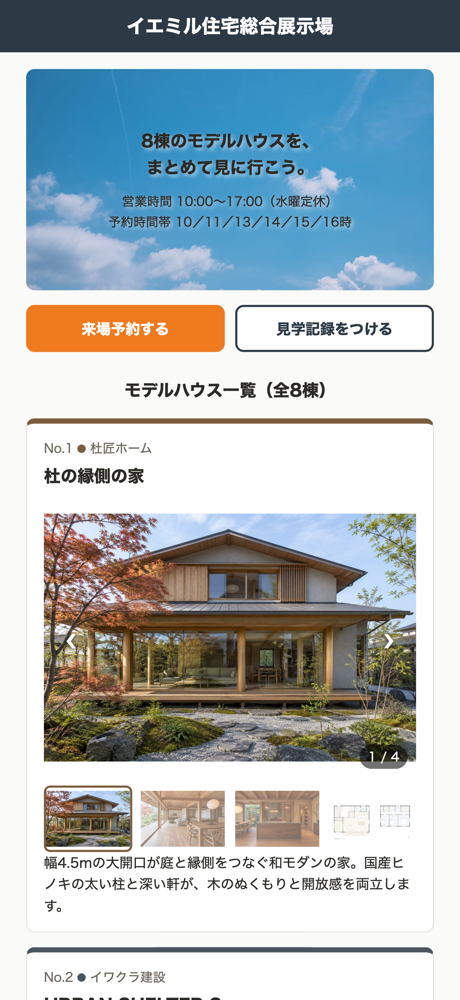                                                    | 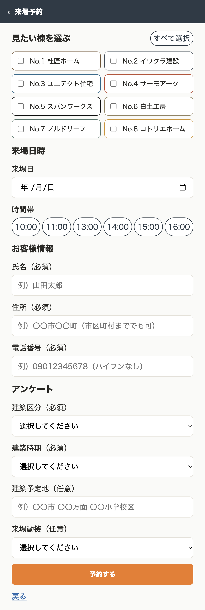 | 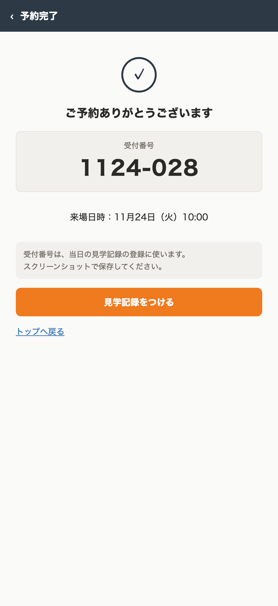 |
| 住宅情報を一覧で確認できます。予約画面・見学記録画面・スタッフログイン画面へ移動できます。 | 見たい棟、日時等を入力して予約をします。  | 受付番号が発行されます。                               |

| 見学記録①                                             | 見学記録②                                             |
| ----------------------------------------------------- | ----------------------------------------------------- |
| 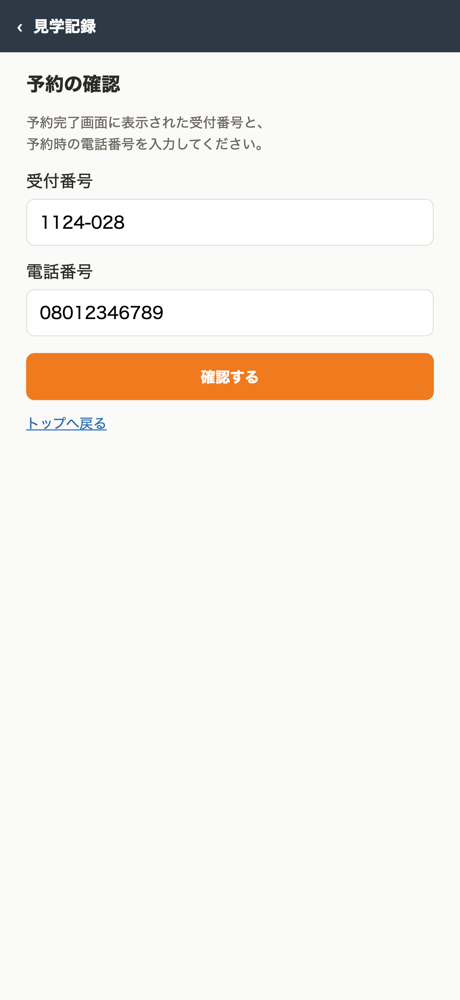 | 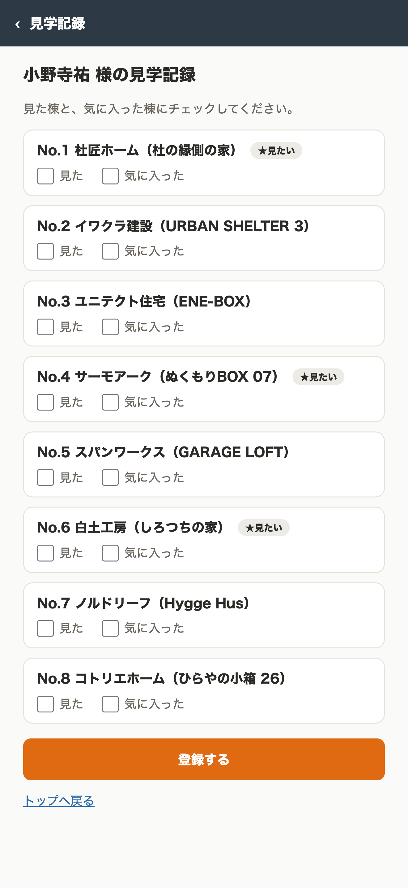 |
| 受付番号と電話番号で予約を確認します。                | 見学記録をつけます。                                  |

### スタッフ画面（PC）

| ログイン                                    | メニュー                                                           |
| ------------------------------------------- | ------------------------------------------------------------------ |
| 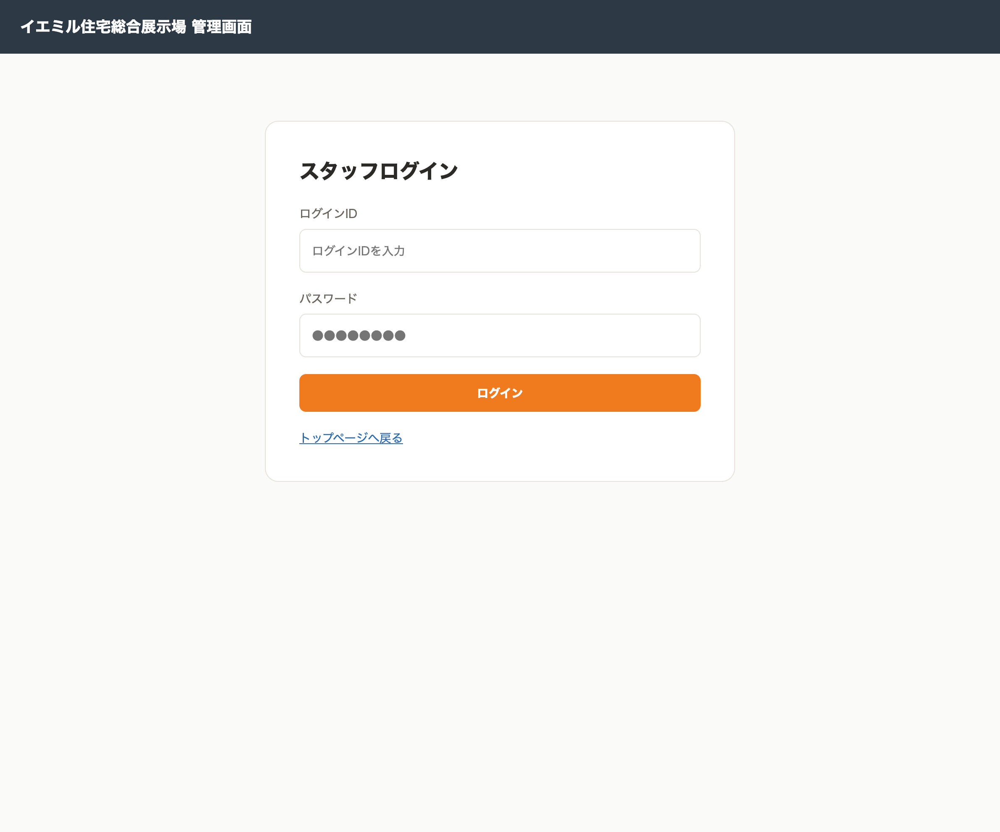 | 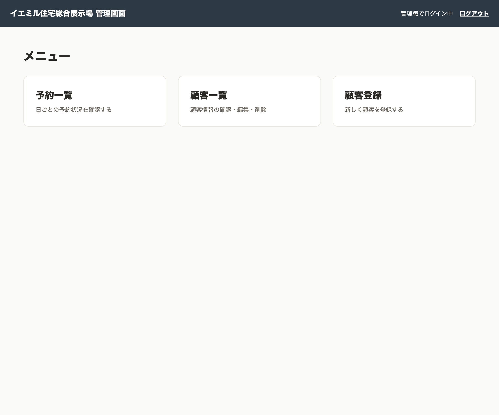                        |
| IDとパスワードでログインします。            | 予約一覧画面と顧客登録画面・管理職のみ顧客一覧画面に移動できます。 |

| 予約一覧                                           | 簡易顧客詳細                                      |
| -------------------------------------------------- | ------------------------------------------------- |
| 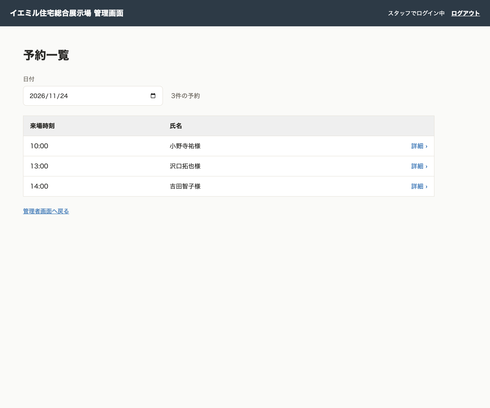 | 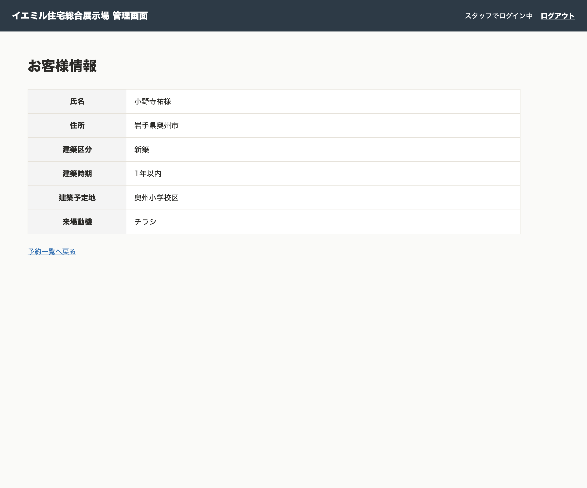 |
| 日毎の予約情報を確認できます。                     | 簡易的な顧客情報を確認できます。                  |

| 顧客一覧                                        | 顧客詳細情報                                       |
| ----------------------------------------------- | -------------------------------------------------- |
| 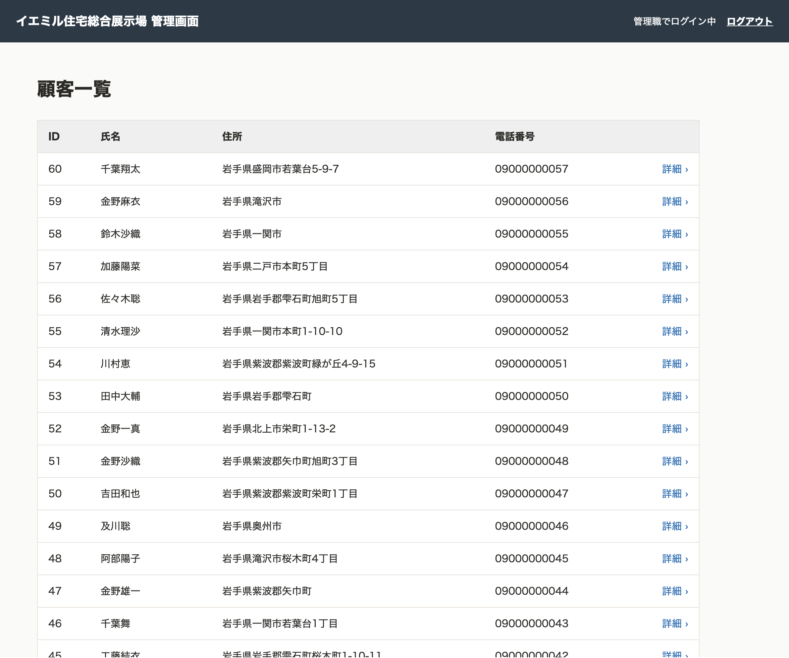 | 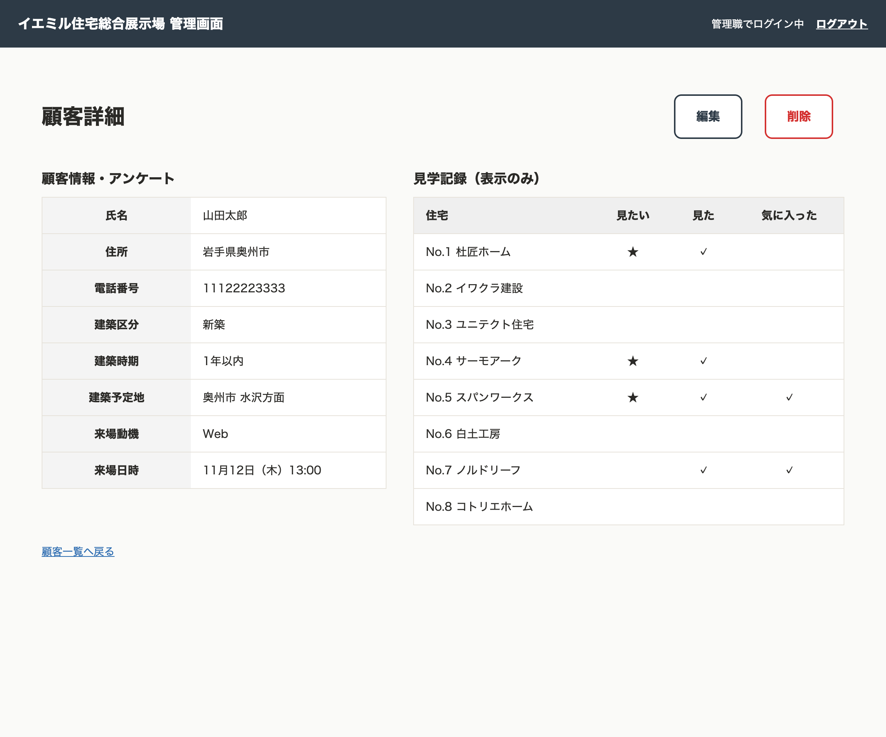 |
| 顧客情報一覧を確認できます。                    | 詳細な顧客情報を確認・編集・削除できます。         |

| 顧客登録                                              |
| ----------------------------------------------------- |
| 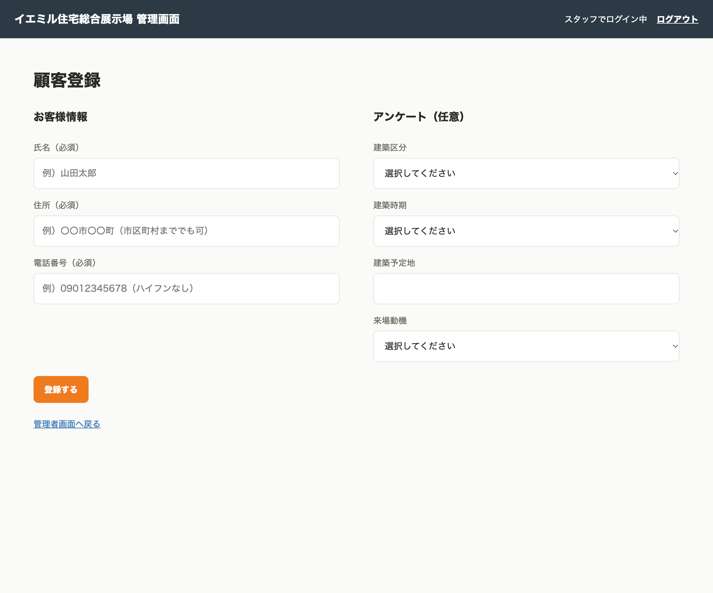 |
| 顧客情報を登録できます。                              |

## 使用技術

| 分類           | 技術                                                   |
| -------------- | ------------------------------------------------------ |
| フロントエンド | JavaScript / React / React Router / Vite / CSS Modules |
| バックエンド   | Java 21 / Spring Boot 4 / Spring Data JPA              |
| 認証           | Spring Security（セッション認証）                      |
| データベース   | MySQL 8.4                                              |
| ビルド・環境   | Maven / npm / Docker Compose                           |
| 設計・その他   | Figma / draw.io / Postman / Git・GitHub                |

## 工夫したところ

- **一般職と管理職で、見られる画面とデータを分けた**
  お客様の個人情報は管理職だけが閲覧できるように、権限ごとに表示する情報を分けました。

- **簡易顧客詳細の住所は、サーバー側で市区町村までに切って送る**
  接客の準備をする際には、どの地域に住んでいるかがわかれば十分なため、市区町村までの表示にするようにしました。

- **予約時に8棟分の見学記録を作っておき、当日は受付番号と電話番号で記録できる**
  お客様の会員登録が不要で、電話番号と受付番号で見学記録を登録できるようにしました。

## 苦労したところ

- **DBの日本語が文字化けしてしまった**

  Dockerの初期化時に、SQLファイルの日本語が正しく読み込まれず、文字化けしていました。
  SQLの最初に `SET NAMES utf8mb4;` を追加して解決しました。

- **フロントエンドとバックエンドの連携**

  サンプルを見たり、生成AIにヒントをもらったりしながら書き進めました。
  APIのリクエストとレスポンスの流れは、Postmanで1つずつ確認しながら理解していきました。

## 起動方法

必要なもの：Docker、Java 21、Node.js

1. 環境変数ファイルを作る
   ```bash
   cp .env.example .env
   ```
2. データベースを起動する（初回は自動でテーブルとサンプルデータが入ります）
   ```bash
   docker compose up -d
   ```
3. バックエンドを起動する（http://localhost:8080）
   ```bash
   cd backend
   ./mvnw spring-boot:run
   ```
4. フロントエンドを起動する（http://localhost:5173）
   ```bash
   cd frontend
   npm install
   npm run dev
   ```

## ER図

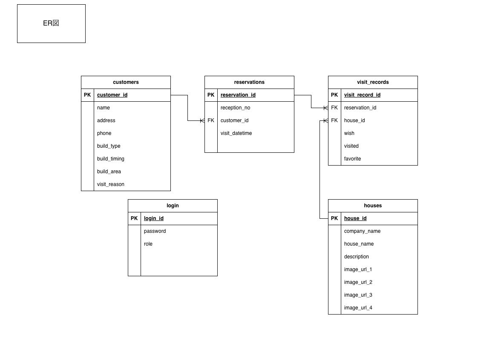

## ログイン情報（動作確認用）

| ID      | パスワード | 権限   |
| ------- | ---------- | ------ |
| staff   | staff      | 一般職 |
| manager | manager    | 管理職 |

## 今後の課題

- 会社ごとの訪問数とお気に入り・来場動機のグラフ化
- CSRF対策（現在は無効にしている）
- テストコードの追加
