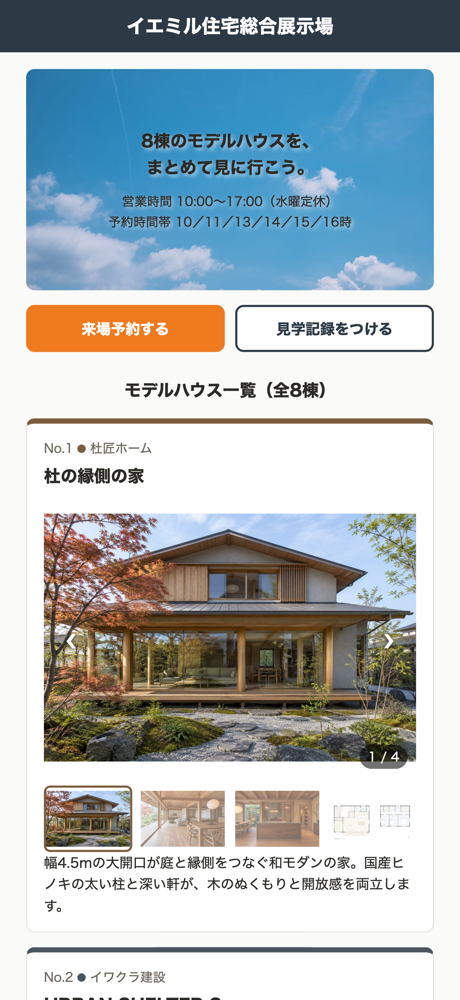
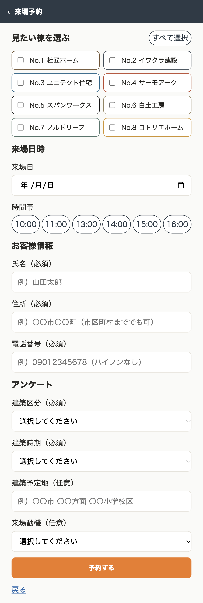
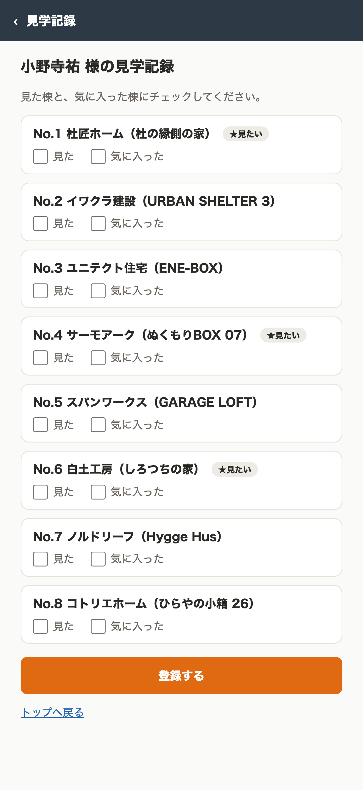
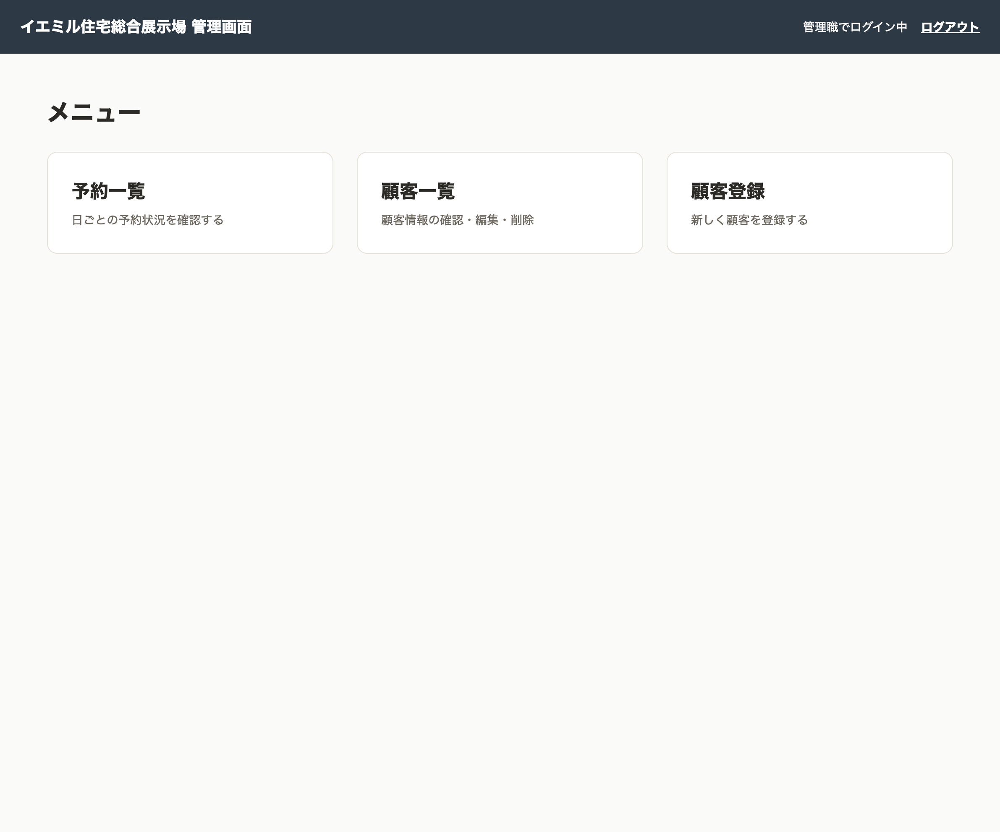
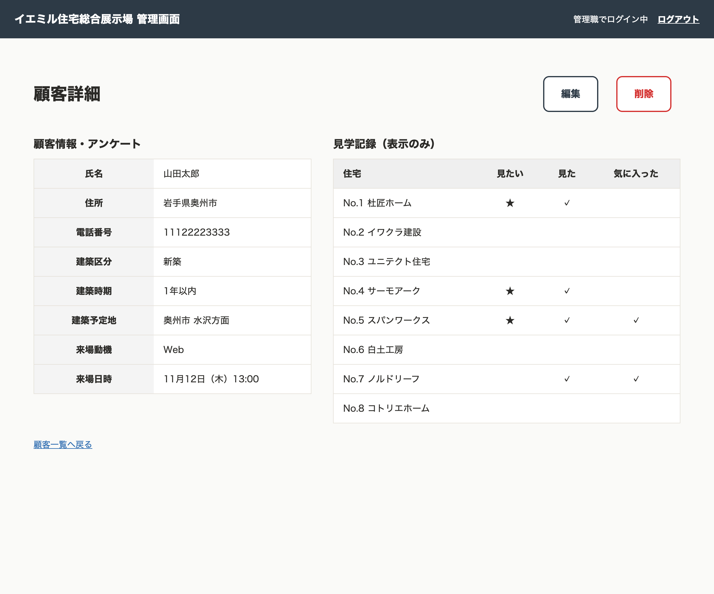

# イエミル住宅総合展示場 来場予約システム

住宅総合展示場の来場予約・見学記録と、スタッフ向けの顧客管理ができるWebアプリです。

## 作った背景

住宅営業の仕事をしていた際に、住宅総合展示場を地域の工務店と合同で運営していました。
お客様は紙に情報を書き、その情報を手入力でスプレッドシートに打ち込む作業を行っていました。
CSVでお客様の情報を探すのも一苦労でした。
こういった、お客様や働く人たちの負担を減らせるようなアプリを作ろうと思い制作しました。

## 主な機能

### お客様

- モデルハウス一覧の閲覧
- 来場予約
- 見学記録の登録

### スタッフ（一般職・管理職）

- ログイン・ログアウト
- 予約状況確認
- 簡易的な顧客情報の確認
- 顧客情報の登録

### 管理職のみ

- 顧客情報一覧確認
- 顧客詳細情報の確認・編集・削除

## 画面

| 管理者画面 |
| ---------- |

 

| 管理者画面 |
| ---------- |





## 使用技術

| 分類           | 技術                          |
| -------------- | ----------------------------- |
| フロントエンド | React                         |
| バックエンド   | Java / Spring Boot 4          |
| データベース   | MySQL                         |
| 設計・その他   | Figma / Postman / Git・GitHub |

## 工夫したところ

- **一般職と管理職で、見られる画面とデータを分けた**
  実際の展示場では、受付スタッフと管理する人で必要な情報が違うため。
  画面のボタンを隠すだけでなく、サーバー側（Spring Security）でも権限をチェックし、
  一般職がURLを直接打っても顧客一覧などは見られないようにした。

- **簡易顧客詳細の住所は、サーバー側で市区町村までに切って送る**
  一般職は、接客に必要な「どの地域のお客様か」がわかれば十分なため。
  画面で隠すだけだと、ブラウザの開発者ツールで住所が全部見えてしまうので、
  そもそも住所を全部送らないようにした。

- **予約時に8棟分の見学記録を作っておき、当日は受付番号と電話番号で記録できる**
  お客様がログインしなくても、その場でスマホから記録できるようにするため。
  受付番号だけだと他人の記録を書き換えられてしまうので、電話番号と両方そろったときだけ確認・登録できるようにした。

## 起動方法

必要なもの：Docker、Java 21、Node.js

1. 環境変数ファイルを作る
   ```bash
   cp .env.example .env
   ```
2. データベースを起動する（初回は自動でテーブルとサンプルデータが入ります）
   ```bash
   docker compose up -d
   ```
3. バックエンドを起動する（http://localhost:8080）
   ```bash
   cd backend
   ./mvnw spring-boot:run
   ```
4. フロントエンドを起動する（http://localhost:5173）
   ```bash
   cd frontend
   npm install
   npm run dev
   ```

## ログイン情報（動作確認用）

| ID      | パスワード | 権限   |
| ------- | ---------- | ------ |
| staff   | staff      | 一般職 |
| manager | manager    | 管理職 |

## 今後の課題

- 会社ごとの訪問数とお気に入り・来場動機のグラフ化
- CSRF対策（現在は無効にしている）
- テストコードの追加
